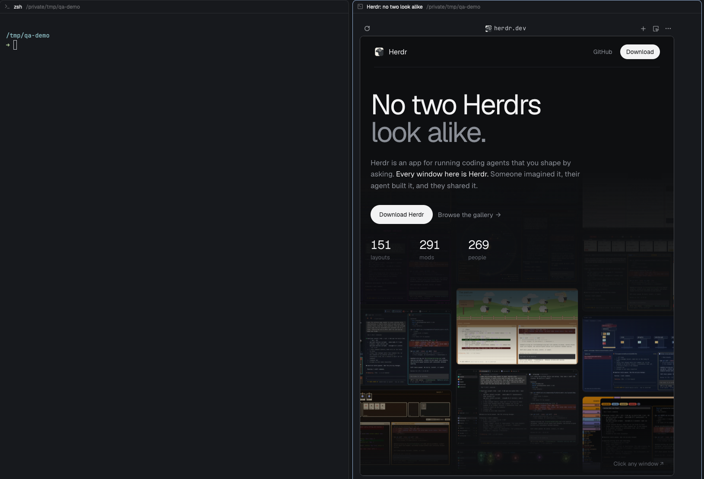
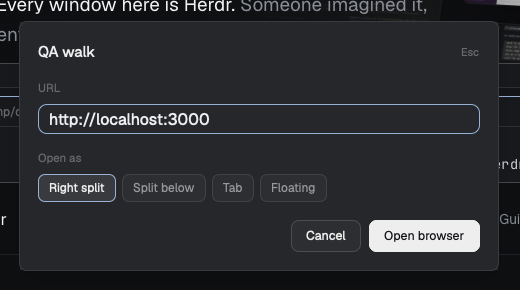
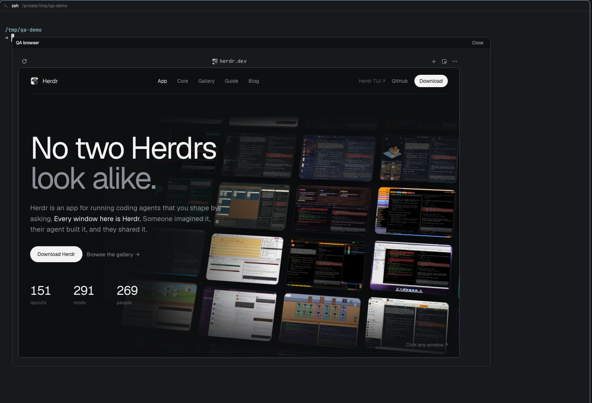

# qa-walk

Let a coding agent walk your web app in a real browser while you watch it live, as a pane beside the conversation. Built for [Herdr](https://herdr.dev) (the native app, with herdr-core `hc`), on top of [terminal-browser](https://github.com/zenbu-labs/terminal-browser).

Two parts, use either or both:

| Part | For | What it is |
|---|---|---|
| `skills/qa-walk` | the agent | an agent skill plus `qa-browser.sh`: install dependencies, open the browser pane, drive it, close it |
| `qa-walk/` (a [herdr.dev mod](https://herdr.dev/mods)) | you | a Herdr app mod: a popup where you type a URL and choose where the browser opens: right split (default), split below, tab or floating window |

Project-agnostic. The project's own rules (which stack, which data, which model, what the report looks like) stay in the project.

## Why

An agent that tests a UI should show its work. terminal-browser renders a real Chromium in a terminal pane, and exposes it to agents through an agent-browser compatible CLI (`snapshot`, `click`, `fill`, `eval`, `screenshot`). This repo adds the missing piece for Herdr: making the pane appear in the right tab, from an agent running in a Herdr terminal.

- `terminal-browser open --split` scripts the terminal it runs in. In Herdr's app it fails with `Ghostty is not running`, because the app reports itself as `ghostty` but is not.
- Fix: start the browser as its own `hc` terminal carrying this tab's `herdr.space` and `herdr.tab` labels. Herdr adopts any terminal with those labels as a pane in that tab. `qa-browser.sh open` does exactly that.



| Popup | Floating window |
|---|---|
|  |  |

## Install

Needs `node`, `terminal-browser`, and inside Herdr `hc`.

```sh
git clone git@github.com:vedovato/qa-walk.git ~/Developer/qa-walk
~/Developer/qa-walk/skills/qa-walk/qa-browser.sh doctor    # what is missing
~/Developer/qa-walk/skills/qa-walk/qa-browser.sh setup     # installs terminal-browser (asks nothing: you run it)
```

Skill, on each machine and agent that should have it (symlinks, so `git pull` updates them):

```sh
ln -sfn ~/Developer/qa-walk/skills/qa-walk ~/.omp/agent/managed-skills/qa-walk   # omp
ln -sfn ~/Developer/qa-walk/skills/qa-walk ~/.claude/skills/qa-walk              # Claude Code
```

Mod, on the machine where the Herdr window runs (or ask your agent: `Read ~/.config/herdr-app/AGENTS.md, then add this mod: herdr.dev/mods/vedovato/qa-walk`). Merge `qa-walk/keys.json` into your `keys.json` for `ctrl-alt-b`:

```sh
ln -sfn ~/Developer/qa-walk/qa-walk/mods/qa-walk ~/.config/herdr-app/mods/qa-walk
herdr-app check ~/.config/herdr-app/mods/qa-walk
herdr-app do mod.open --name qa-walk     # toggles the popup; bind a key to mod.open to keep it handy
```

`setup` installs `terminal-browser` with `brew install` when brew exists, else the vendor's `curl | bash` installer. It never installs `node` or `hc`. An agent should run it only after you agree.

## Use

The agent opens, drives and closes the browser:

```sh
S=~/Developer/qa-walk/skills/qa-walk/qa-browser.sh
$S open https://app.localhost:3000/                       # pane appears; prints the browser key
KEY=$($S key)
env -u TERM_PROGRAM terminal-browser action --browser $KEY -- snapshot -i
env -u TERM_PROGRAM terminal-browser action --browser $KEY -- click @e3
env -u TERM_PROGRAM terminal-browser action --browser $KEY -- screenshot /tmp/walk/s1.png
$S stop                                                   # clears the outline, closes the pane
```

The outline you see around the page means the agent is acting. `stop` clears it.

## Make the agent use it, and nothing else

A skill alone does not stop an agent from reaching for Playwright. Put the rule where every session reads it (`CLAUDE.md` or `AGENTS.md` of the project):

```md
## QA walks
- Browser walks use `terminal-browser` only, through the `qa-walk` skill (`qa-browser.sh doctor|setup|open|go|stop`).
- Never install or run Playwright, Puppeteer, Selenium or another browser driver, and never fall back to one: stop and report instead.
- A walk is a check, not a gate: it does not replace the human's own checks.
- Run `qa-browser.sh setup` only after the human agrees.
```

The skill's own `description` triggers on "qa walk", "walk-through", "browser walk", so a plain request loads it.

## Where it runs

| Agent runs in | How `open` makes the pane | Status |
|---|---|---|
| Herdr app (hc terminal, `$HC_TERMINAL_ID`) | labelled hc terminal, adopted as a pane | tested |
| Herdr TUI pane (`HERDR_ENV=1`) | `terminal-browser open --split right` | untested |
| Ghostty, kitty or another supported terminal | `terminal-browser open --split right` | untested |

If the agent runs on one machine and the Herdr window on another (an `hc machine`), the browser runs where the agent's core is. Install `terminal-browser` there. The mod's `terminal-browser open` runs on the focused pane's machine.

## Limits

- `stop` outside hc runs `terminal-browser shutdown`, which closes every terminal-browser, not just this one.
- Chromium refuses self-signed certificates. Over CDP on the browser's `cdpPort` (`terminal-browser ls --all --json`) send `Security.setIgnoreCertificateErrors {ignore:true}`, then `Page.navigate`. `*.localhost` resolves to `::1` first, so a test proxy must listen dual-stack.
- The mod only opens the browser; its floating window is an unlabeled core terminal that never shows in a tab, so a lost one is ended with `hc ls` and `hc kill <address>`.
- The mod only opens the browser. Closing it is `ctrl+q` in the pane, or the agent's `stop`.
- No CI: this is an interactive helper, not part of any build.

## Layout

```
skills/qa-walk/SKILL.md        agent instructions
skills/qa-walk/qa-browser.sh   doctor | setup | open | go | key | stop
qa-walk/RECIPE.md              the brief herdr.dev lists the mod from
qa-walk/preview.png            listing picture (also popup.png, floating.png)
qa-walk/keys.json              optional key binding to merge
qa-walk/mods/qa-walk/          Herdr app mod (gpui-kit): main.js, mod.json
```

## Listing

The repo carries the topic `herdr-mod`, so [herdr.dev/mods](https://herdr.dev/mods) lists the mod from `qa-walk/` within the hour.

## License

MIT
