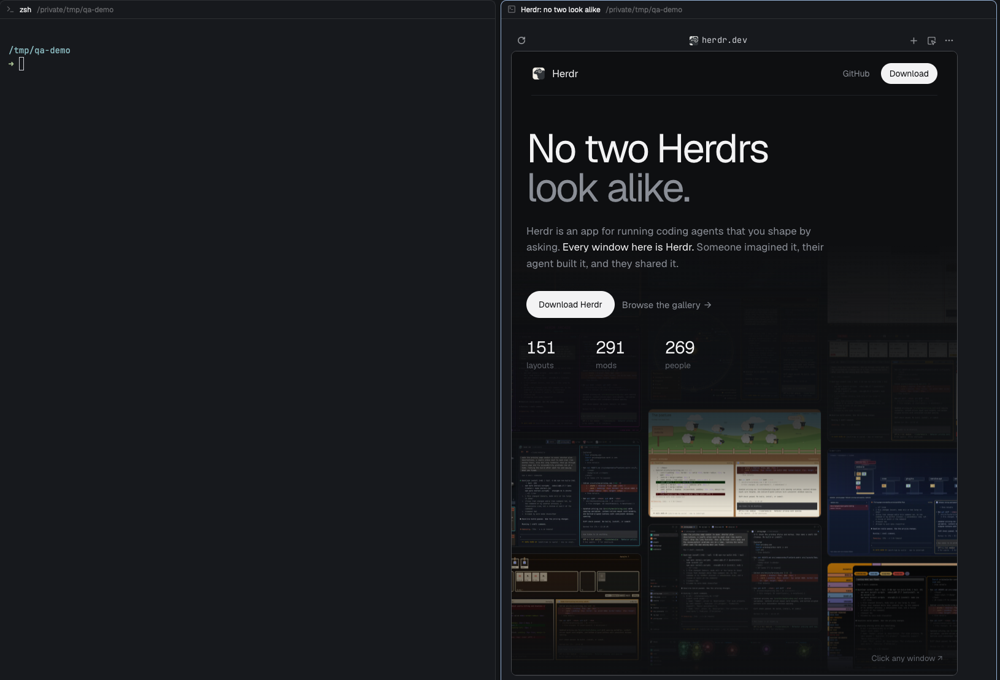
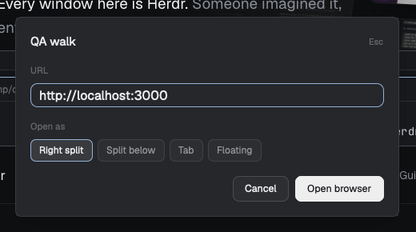

# QA walk

A small popup for opening a real browser beside your terminals. Type a URL, choose where it opens (right split, split below, tab or a floating window) and press Enter. [terminal-browser](https://github.com/zenbu-labs/terminal-browser) opens there, so an agent or you can walk a web app while you watch. Nothing is added to the layout itself.

## What you see

- A popup, 480px wide and 250px high, opened at the pointer. Your theme's popup background and foreground, 18px padding.
- A header row: "QA walk" (15px, semibold) on the left, "Esc" (11px, dim) on the right.
- A "URL" label (11.5px, dim) over a 36px text input, 10px side padding, 9px corners, accent border while focused. It starts with the last URL used, else `http://localhost:3000`, selected so typing replaces it.
- An "Open as" label over four 28px segments with 6px gaps: "Right split", "Split below", "Tab", "Floating". The chosen one has the selected background and an accent border; the others use the raised background and muted text. The last choice is remembered; the first run chooses "Right split".
- A footer, right-aligned, 8px gap: "Cancel" and a primary "Open browser" button (32px high, 8px corners).
- Floating only: a window 70% of the Herdr window wide and 75% high, centered, with a 30px title bar ("QA browser" on the left, "Close" on the right) above the browser. Drag it by the title bar.

## How it behaves

- Enter in the input, or the primary button, opens the browser at the chosen place and closes the popup. Esc and Cancel close it without opening anything. An empty URL does nothing.
- **Right split / Split below:** a new terminal beside or below the focused pane runs `terminal-browser open <url>`. **Tab:** a new tab named "browser" in the current space runs it.
- **Floating:** the browser starts as its own core terminal, not shown in any tab, and a draggable window shows it. "Close" ends that terminal and the window closes with it. The window also closes when you quit the browser inside it.
- The browser is always where the focused pane is: for a space on another machine it runs on that machine, so `terminal-browser` must be installed there.
- Quit a split or tab browser with ctrl+q inside it; the pane closes when the program exits.
- Scriptable while the popup is open: `herdr-app do terminal-browser-qa.url=<text>`, `terminal-browser-qa.place-right|place-down|place-tab|place-float` and `terminal-browser-qa.submit` do what typing, choosing and pressing Enter do. The mod reads them with `nextCommand()`.
- Agent status colors do not apply: the mod shows no agents.

## Built from

- **One mod**, `mods/terminal-browser-qa/`, with `main.js` and `mod.json`. `mod.json` is `{ "place": "none", "title": "QA walk", "overlay": { "kind": "popup", "width": 480, "height": 250 } }`: nothing is added to a layout and there is no `layouts/` folder.
- **A `keys.json` snippet** with `ctrl-alt-b` bound to `mod.open:terminal-browser-qa` under `global` and `terminal`. Merge it into the person's keys and ask before replacing a key they already use.
- **A `View`** using `gpui-kit` and `gpui-base` (`Input`, `InputState`, `h_flex`, `v_flex`) and `theme()` colors. The same module renders the floating window's title bar when its props say `mode: "titlebar"`, so the window needs no second mod.
- **Commands and functions from `herdr`:**
  - `run("terminal.open", { argv: ["terminal-browser", "open", url], place, name })` with `place` one of `right`, `down`, `tab`;
  - for floating, `hc(["run", "--json", "--bg", "--no-parent", ("--on", machine)?, "terminal-browser", "open", url])` returns `{ address }`, and `openOverlay({ kind: "window", key: "qa-walk-float", width: 0.7, height: 0.75, layout })` shows a column of a 30px title-bar block (this mod, `mode: "titlebar"`) and a terminal block `{ terminal: address }`; the window closes itself when that terminal ends;
  - `run("terminal.kill", { terminal })` from the title bar's Close;
  - `shared`/`setShared` for the remembered URL (`qa-walk.url`) and place (`qa-walk.place`);
  - `spaces()` and `focused()` to find the focused space's machine.
- **Commands from outside:** a `cx.spawn` loop on `nextCommand()` handles `url=<text>` (sets the input with `set_value`), `place-<place>` and `submit` (calls the same `open` as Enter).
- **Programs it runs:** `terminal-browser` and `hc`. It reads no files and uses no network itself. Say so before adding it.

## Watch out

- Checked with `herdr-app 0.1.12`; follow the installed `herdr.d.ts` and `gpui-kit.d.ts` if they differ.
- Needs `terminal-browser` on the machine where the focused pane runs. Without it the new pane shows `command not found`.
- `terminal-browser open --split` does not work inside Herdr (it reports "Ghostty is not running": Herdr identifies as ghostty). That is why the mod opens the browser as the new terminal's own program instead.
- A shown popup keeps its state between openings. After editing `main.js`, saving reloads it; remembered values come from shared state, not from the copy.
- The floating browser is an unlabeled core terminal: it never appears in a tab or the agents list. If the window is lost, end it with `hc ls`, then `hc kill <address>`.
- Floating windows are closed by a layout switch.
- Drag the floating window only by its title bar: presses inside the browser go to the page.
- Shared keys are global to all mods; the `qa-walk.` prefix avoids clashes.

## Done when

- `herdr-app check mods/terminal-browser-qa` passes with the matching Herdr binary.
- `herdr-app do mod.open --name terminal-browser-qa` shows the popup with "Right split" chosen on a fresh home; running it again closes it.
- Enter on `https://herdr.dev` with "Right split" opens a pane to the right showing the page; "Split below" opens one below; "Tab" opens a tab named "browser".
- With "Floating", a window with a "QA browser" title bar opens over the layout, can be dragged by the bar, and "Close" removes it and ends its terminal (`hc ls` shows no `terminal-browser` left).
- With the popup open, `herdr-app do terminal-browser-qa.url=https://herdr.dev`, `terminal-browser-qa.place-down` and `terminal-browser-qa.submit` open the page in a pane below the focused one; with `place-tab` a second tab; with `place-float` the floating window.
- The chosen place and URL are still selected the next time the popup opens.
- Esc closes the popup and changes nothing.
